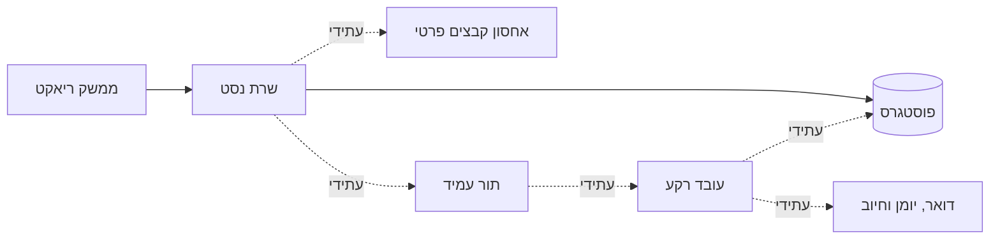

# ארכיטקטורה

## החלטת יסוד

יישום מודולרי אחד, עם תהליך שרת ועובד רקע נפרד כשיידרש. אין צורך כרגע
בשירותים זעירים, במנוע חיפוש חיצוני או במטמון. ראו החלטה ADR-001.

## מבנה המאגר

- apps/web: ריאקט, טייפסקריפט וויט; כרגע מסך סטטוס בלבד.
- apps/api: נסט, טייפסקריפט; כרגע זמינות ומוכנות בלבד.
- packages/database: חיבורים, הקשר עסקי, גרסאות מבנה ובדיקות שילוב.
- apps/worker: חוזה מתועד בלבד; אין תהליך פעיל.
- docs: מקור ההחלטות, המפרט, התוכנית וממצאי הניסוי.
- infra: תשתית פיתוח; אינה תצורת ייצור.

## בידוד

מסד משותף עם מזהה עסק בכל רשומה ו־RLS כפוי. מפתח לקוח מורכב ממזהה עסק
ומזהה רשומה; קשרים עתידיים ישתמשו בשניהם כדי למנוע שיוך חוצה־עסקים.
חשבון crm_app אינו בעל טבלאות, אינו מנהל ואינו רשאי לעקוף RLS.
לשינויי מבנה יש חשבון נפרד שאינו משמש בקשות משתמשים.

withTenant מגדיר הקשר בתוך עסקה בלבד, מחזיר שינויים בכשל ומנקה את ההקשר
לפני שימוש חוזר בחיבור. הקלט שלו חייב להגיע מחברות עסקית מאומתת. הוא אינו
מנגנון הזדהות ואינו מוכיח שהמשתמש מורשה. אין עדיין נתיבי לקוחות בשרת.
לפני הוספתם יש לממש חברות, תפקיד והיקף אישי/צוותי, מעבר לבידוד המסד.

בידוד יורחב לקבצים, תורים, חיפוש, מטמון, יצוא ודוחות כשאלה ימומשו.

## ממשקים קיימים

| נתיב                     | משמעות                                          |
| ------------------------ | ----------------------------------------------- |
| GET /api/v1/health/live  | התהליך פעיל; אינו מוכיח זמינות מסד              |
| GET /api/v1/health/ready | המסד נגיש, טבלת היסוד קיימת ותפקיד החיבור מוגבל |

מוכנות מחזירה 503 בכשל בלי פרטי חיבור. זוהי בדיקת תשתית מצומצמת, ולא
הוכחה לתקינות כל מדיניות האבטחה; לשם כך נדרשות בדיקות השילוב.
אין כרגע הזדהות, חוזי נתונים עסקיים, תור או ספק חיצוני.

## חוזי המערכת העתידית

- מזהים קבועים; זמנים מוחלטים נשמרים באופן אחיד ומוצגים באזור זמן המשתמש.
- ממשק מתועד ובעל גרסאות, עימוד חסום, מיון יציב ושגיאות ללא מידע פנימי.
- קלט מאומת בשרת. שאילתות עם פרמטרים; אין חיבור מחרוזות מקלט לשאילתות.
- פעולות עסקיות אטומיות; גרסת רשומה לזיהוי עריכה מקבילה.
- יצוא, ייבוא וסנכרון גדולים ברקע, עם מכסות לפי עסק.
- אירועים אמינים ומניעת כפילות לפעולות חיצוניות; לשקול תיבת אירועים
  באותה עסקת מסד לפני הכנסת פעולות תלויות־מסירה.
- משימות רקע נושאות זהות עסק, בודקות הרשאות עדכניות וניסיונות מוגבלים.
- ספקי זהות, דואר, חיוב ואחסון ייבחרו בהחלטות נפרדות. לא נבנה מנגנון
  סיסמאות או קריפטוגרפיה עצמאי ללא צורך וביקורת.

## הפעלה

סביבות פיתוח, בדיקות וייצור מופרדות. ייצור ידרוש שירותי מסד ואחסון מנוהלים,
הצפנה, ניהול סודות, תעודה, הגבלות תעבורה, ניטור וגיבויים מוכחים. שרת ויט
וקובץ compose הם לפיתוח בלבד. אין כיום תצורת פריסה מסחרית.
